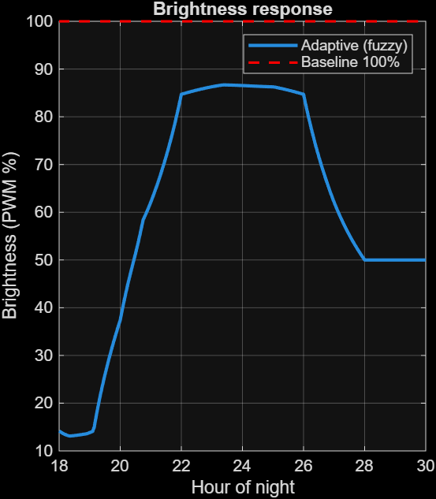
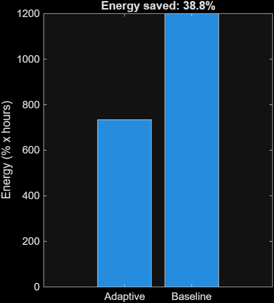
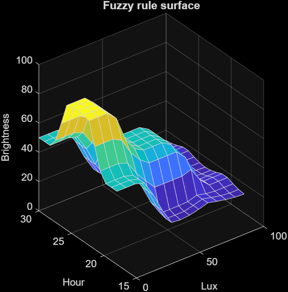
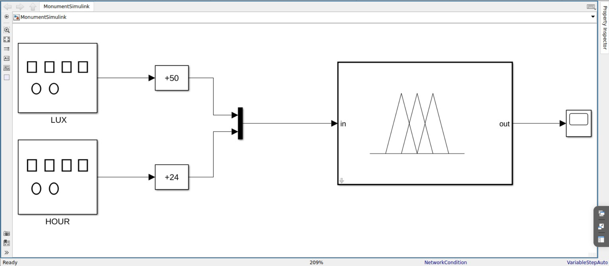
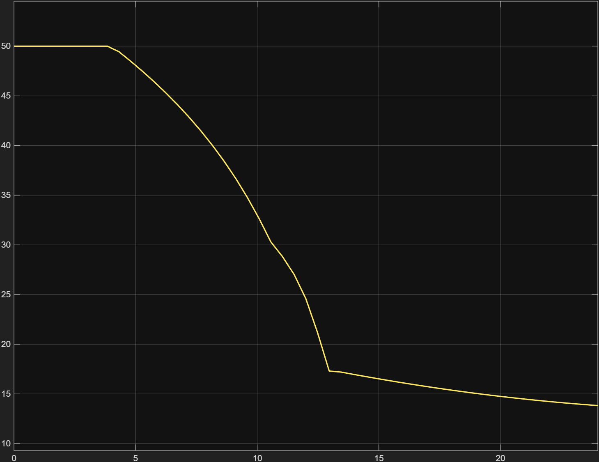
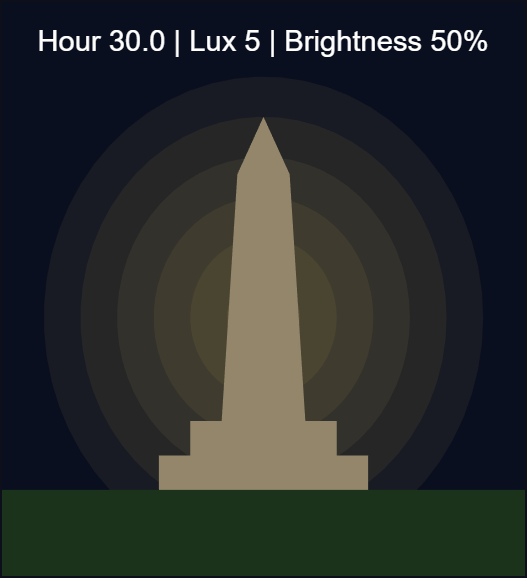

# Smart Adaptive Energy-Efficient Monument Illumination System

A fuzzy logic controller (MATLAB / Simulink) that adjusts monument lighting brightness from ambient light and time of night, instead of running at full brightness all night.

Academic project for EEE111 (Electrical Power Generation & Utilization), NMAMIT, Nitte. Software simulation only; no hardware was built.

**Result: 38.8% less energy than constant full-brightness lighting, in simulation.**

## Problem

Monuments and public landmarks are usually lit at constant full brightness all night, even when ambient light is already high (dusk, moonlight) or when late-night visibility needs are lower. That wastes electricity. This project shows how a fuzzy controller can reduce that waste automatically.

## Approach

A Mamdani Type-1 fuzzy inference system, built in MATLAB Fuzzy Logic Designer, with two inputs and one output:

| Variable | Range | Membership functions (triangular) |
|---|---|---|
| Lux (input) | 0 to 100 | Dark [0 0 40], Dim [20 50 80], Bright [60 100 100] |
| Hour (input) | 18 to 30 (6 PM to 6 AM) | Evening [18 18 22], Midnight [20 24 28], LateNight [26 30 30] |
| Brightness (output) | 0 to 100 (PWM %) | Low [0 0 40], Medium [20 50 80], High [60 100 100] |

Inference settings: AND = min, OR = max, implication = min, aggregation = max, defuzzification = centroid.

### Rule base (9 rules)

| Lux | Evening | Midnight | LateNight |
|---|---|---|---|
| Dark | Medium | High | Medium |
| Dim | Low | Medium | Low |
| Bright | Low | Low | Low |

In plain words: the darker it is and the deeper into the night, the brighter the lights. When there is already plenty of ambient light, the lights stay low.

## What was built

1. **Fuzzy controller** (`Monument_Lighting.fis`): the 2-input, 1-output Mamdani system above.
2. **Simulink model** (`MonumentSimulink.slx`): Lux and Hour signal generators, offset blocks, a Mux, the Fuzzy Logic Controller block, and a Scope. It confirms the controller gives a changing, sensible brightness output over a simulated 24-hour cycle (1 second = 1 hour).
3. **Energy analysis** (`Monument_Analysis.m`): runs the controller against a simulated 12-hour night, integrates brightness over time, and compares the energy with a constant 100% baseline. It also draws the plots and an animated monument.

## Files

| File | Purpose |
|---|---|
| `Monument_Lighting.fis` | The fuzzy controller |
| `MonumentSimulink.slx` | Simulink model |
| `Monument_Analysis.m` | Energy analysis, plots and monument animation |

## How to run

Requires MATLAB with the Fuzzy Logic Toolbox. Put all files in one folder.

- **Analysis script:** run `Monument_Analysis`. It prints the adaptive and baseline energy and saved percentage, then opens the plots and animation.
- **Simulink model:** in the MATLAB command window run `fis = readfis('Monument_Lighting');`, then open `MonumentSimulink.slx` and press Run (stop time 24).

## Results

The test profile is a synthetic 12-hour night (6 PM to 6 AM). Ambient lux starts higher at dusk, decays exponentially, and has a small periodic ripple. Energy is the integral of brightness over time, compared with constant 100% lighting.

### Brightness response

Brightness stays low in the early evening, peaks at about 85% in the darkest hours, then tapers toward late night. The red dashed line is the constant 100% baseline.

### Energy comparison

The adaptive controller uses 38.8% less energy than the constant baseline over the simulated night.

### Fuzzy rule surface

The surface shows brightness as a function of Lux and Hour. It is smooth, and brightness rises as lux falls and the night deepens.

### Simulink validation

Simulink model: Lux and Hour signal generators, offset blocks, Mux, Fuzzy Logic Controller block, and Scope.

Controller output over a simulated 24-hour cycle (1 second = 1 hour). This is a separate test signal from the 12-hour energy analysis above, so the two curves are not meant to match.

### Monument animation

The animation dims and brightens a monument graphic in step with the controller output.

## Limitations

- Results come from a simulated lux profile, not measured field data, so the 38.8% figure is indicative only.
- Software simulation only. No sensors, microcontroller, or lamp driver were built.
- Membership functions and rules were chosen by hand and not tuned against real data.

## Future scope

- Hardware prototype: LDR light sensor, RTC module, PWM LED driver, and a microcontroller (Arduino or ESP32) running the same rule base.
- A third input such as motion or footfall.
- Field logging to validate the energy saving.

## Tools

MATLAB, Fuzzy Logic Designer, Simulink.

## Author

Manvith U M, Electrical and Electronics Engineering, NMAMIT, Nitte.
Guide: Gururaj K, Assistant Professor Gd-II, NMAMIT.
